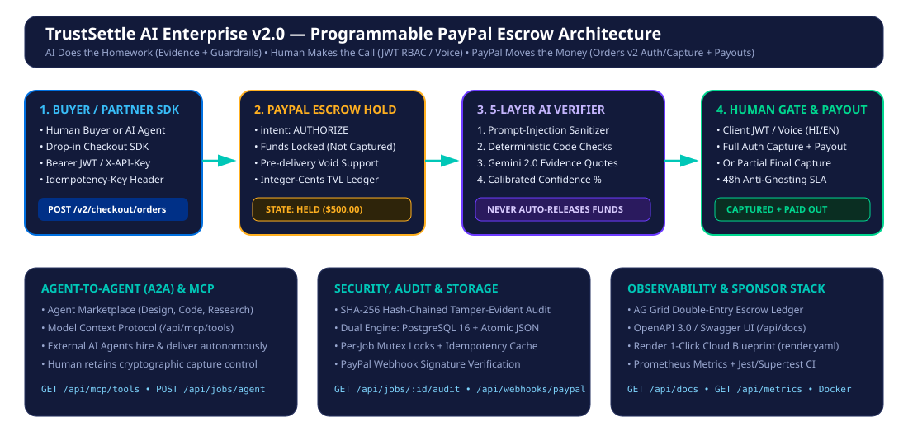

# TrustSettle AI — Enterprise v2.0 (PayPal-Ready Programmable Escrow)

[](https://render.com/deploy?repo=https://github.com/matricphase-dot/trustsettle-ai)
[](https://github.com/matricphase-dot/trustsettle-ai/blob/main/LICENSE)
[](https://github.com/matricphase-dot/trustsettle-ai)



**Programmable Escrow Infrastructure for Humans & AI Agents** — Built on **PayPal Orders v2 (`intent: AUTHORIZE`), Authorizations Capture/Void v2, Payouts v1, and Webhooks v1**, fortified with **Evidence-Grounded AI Verification, Mandatory Human Sign-Off, RBAC, Idempotency, and SHA-256 Tamper-Evident Audit Chains**.

---

## Why PayPal Can Deploy This Today

Standard marketplaces force an ugly trade-off: either buyers pay upfront and risk non-delivery, or freelancers deliver first and risk non-payment/ghosting. Naive "AI auto-release" escrows fail in production due to **LLM hallucinations, prompt injection, and double-spend race conditions**.

**TrustSettle AI v2.0** solves all three with bank-grade fintech engineering:

1. **Exact PayPal Payments v2 Authorization Lifecycle**:
   - Locks funds via `POST /v2/checkout/orders` (`intent: AUTHORIZE`) → `authorization_id`.
   - Releases funds via `POST /v2/payments/authorizations/{id}/capture` + `POST /v1/payments/payouts`.
   - Executes **Smart Fair-Split Settlements** using **`final_capture: true` partial captures** on the PayPal Authorization — automatically releasing the uncaptured hold back to the buyer's card/wallet with **$0 refund fee**!
   - Supports pre-delivery `POST /v2/payments/authorizations/{id}/void` and cryptographic webhook verification (`/v1/notifications/verify-webhook-signature`).

2. **5-Layer Anti-Hallucination & Trust Architecture**:
   - **Sanitizer Guard**: Strips adversarial prompt-injection vectors (`ignore previous instructions`, `score 100`) and caps untrusted payloads.
   - **Deterministic Code Checks**: URL/artifact verification, brief keyword coverage, editable source-file checks (`AI/EPS/Figma/GitHub`). Critical failures override LLM generosity.
   - **Evidence-Grounded Rubric**: AI must quote exact delivery fragments for Completeness (40%), Quality (30%), Originality (20%), and Timeliness (10%).
   - **Mandatory Human Gate**: AI *never* auto-releases money (`POST /release` is hard-blocked). `APPROVE` transitions to `PENDING_APPROVAL` for human sign-off (click or **Hindi/English Voice Approval**).
   - **48h Anti-Ghosting Time-Lock Worker**: Protects freelancers if a buyer ghosts after verified delivery (`ESCALATED` → Arbitrator resolution).

3. **Enterprise Fintech Controls**:
   - **JWT RBAC + Partner API Keys (`X-API-Key`)**: Separate `CLIENT`, `FREELANCER`, `AGENT`, `ARBITRATOR`, and `MERCHANT_ADMIN` permissions.
   - **Idempotency-Key Replay Cache + Per-Job Mutex Locks**: Zero double-charges or double-payouts on network retries.
   - **Integer-Cents Accounting & Double-Entry Ledger**: Eliminates IEEE-754 floating-point drift; visualized live in **AG Grid**.
   - **SHA-256 Cryptographic Audit Chain**: Every state transition links `prevHash -> hash` (`GET /api/jobs/:id/audit` verifies tamper-free integrity).
   - **Drop-In Merchant Checkout SDK (`/sdk/trustsettle-sdk.js`) + MCP Agent Server (`/api/mcp/tools`)**: Marketplaces embed PayPal Escrow in 5 lines of JS; external AI agents transact via Model Context Protocol.

---

## Quick Start (Zero-Config Local OR Live Cloud)

```bash
npm install
npm test        # Runs full Jest + Supertest integration & security suite
npm start       # Starts server on http://0.0.0.0:3000
```

- **Command Center UI**: `http://localhost:3000`
- **Interactive OpenAPI / Swagger Docs**: `http://localhost:3000/api/docs`
- **MCP Agentic Tool Manifest**: `http://localhost:3000/api/mcp/tools`
- **Prometheus Metrics**: `http://localhost:3000/api/metrics`

### Going Live with PayPal Sandbox / Production + PostgreSQL

Copy `.env.example` to `.env` and set:
- `PAYPAL_CLIENT_ID` & `PAYPAL_CLIENT_SECRET` (`PAYPAL_ENV=sandbox` or `live`)
- `PAYPAL_WEBHOOK_ID` (for cryptographic webhook signature checks)
- `XAI_API_KEY` (enables Grok evaluation; takes precedence over Gemini)
- `XAI_MODEL` (optional; defaults to `grok-3-mini`; choose a model available to your xAI account)
- `GEMINI_API_KEY` (optional alternative for Gemini evaluation)

When the configured AI provider fails, verification falls back to the deterministic rubric. Provider configuration alone does not verify API connectivity. Human approval remains required.
- `DATABASE_URL` (switches automatically from atomic JSON store to PostgreSQL 16; run `npm run db:migrate`)

### Docker + PostgreSQL 16 Deployment

```bash
docker compose up --build -d
```

### 1-Click Render Cloud Deploy

Includes `render.yaml` Blueprint for instant deployment on Render with health checks on `/api/health`.

---

## Project Structure

```text
trustsettle-ai-prod/
├── src/
│   ├── config/index.js          # Validated env config (PayPal, AI, JWT, Postgres)
│   ├── db/
│   │   ├── schema.sql           # PostgreSQL 16 DDL (users, api_keys, jobs, ledger, idempotency)
│   │   ├── index.js             # Dual adapter (PostgreSQL + Atomic JSON) + mutex locks + cents math
│   │   ├── migrate.js           # SQL migration runner
│   │   └── seed.js              # Default personas, AI agents & partner API key
│   ├── middleware/
│   │   ├── auth.js              # Bearer JWT + X-API-Key + RBAC enforcement
│   │   ├── idempotency.js       # Idempotency-Key response caching
│   │   ├── validate.js          # Zod request body validation
│   │   └── errorHandler.js      # X-Request-Id correlation + structured error handler
│   ├── services/
│   │   ├── paypal.js            # Orders v2, Authorizations Capture/Void, Refunds, Payouts, Webhooks
│   │   ├── ai.js                # Sanitizer, Deterministic Checks, Gemini 2.0 + Smart Settlement Split
│   │   └── timelock.js          # 48h Anti-Ghosting SLA sweep worker
│   ├── routes/
│   │   ├── auth.js              # /api/auth/token, /api/auth/personas, /api/auth/api-keys
│   │   ├── jobs.js              # Full escrow state machine + audit chain verification
│   │   ├── agents.js            # Agent Marketplace (A2A) + MCP server (/api/mcp/tools)
│   │   └── system.js            # /api/health, /api/metrics (Prometheus), /api/ledger, /api/webhooks
│   ├── utils/
│   │   ├── auditChain.js        # SHA-256 tamper-evident hash chain
│   │   └── logger.js            # Pino structured JSON logger with secret redaction
│   ├── app.js                   # Express app factory + Helmet + Rate Limit + Swagger UI
│   └── server.js                # 0.0.0.0 HTTP entrypoint + graceful SIGTERM shutdown
├── public/
│   ├── index.html               # Enterprise Command Center UI + AG Grid Ledger
│   ├── app.js                   # Live RBAC switcher, Voice Approval, Audit Inspector
│   ├── styles.css               # PayPal dark enterprise theme
│   └── sdk/trustsettle-sdk.js   # 5-line embeddable Partner Checkout SDK
├── docs/openapi.yaml            # OpenAPI 3.0 specification (APIMatic & Swagger ready)
├── tests/escrow.test.js         # Jest + Supertest end-to-end & security test suite
├── Dockerfile & docker-compose.yml
└── render.yaml
```

## License

MIT License — see [LICENSE](./LICENSE).
